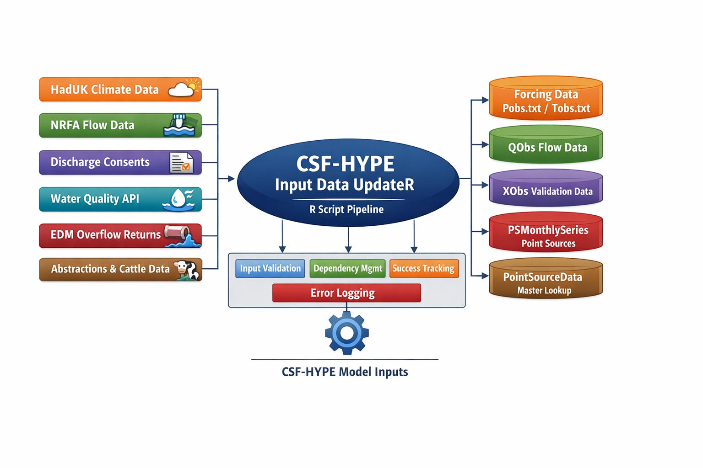

# CSF-HYPE Input Data UpdateR

A resumable, auditable **R-based data pipeline** for generating and updating all input datasets required by the CSF-HYPE hydrological and water-quality model.

---

## Overview

**CSF-HYPE Input Data UpdateR** automates the preparation of model inputs including:

- Meteorological forcing data
- Observed flow datasets (QObs)
- Water quality observations (XObs)
- Point-source discharges
- Abstractions
- Intermittent overflows
- Cattle-in-Streams inputs

The pipeline executes a fixed sequence of R scripts with:

- Input validation  
- Automatic dependency ordering  
- Resume capability  
- Full provenance tracking  
- Error logging & diagnostics  

---

## Key Features

- **Resumable execution** — completed steps are skipped automatically
- **Auditable workflow** — metadata recorded for every step
- **Incremental updates** — downloads only new data
- **Robust error handling**
- **Deterministic outputs**
- **Operationally repeatable**

---

## Repository Structure

```
CSFHYPE_Input_Data_updateR/
│
├── 00_Master_Runner_Input_Data_UpdateR.R
├── Scripts/
│
├── ForcingData/        # Meteorological inputs
├── GeoData/            # Spatial datasets
├── PointSourceData/    # Discharges & abstractions
├── QObs/               # Observed flows
├── XobsData/           # Cross-validation data
├── Status_tracking/    # Pipeline state files
└── pipeline_run.log
```

---

## Pipeline Workflow

The pipeline runs 15 ordered steps:

```
1  Update forcing data (HadUK)
2  Extract NRFA flow data
3  Process discharge consents
4  Update monitoring observations
5  Prepare discharge inputs
6  Collate EDM returns
7  Build intermittent discharges
8  Build abstractions series
9  Build Cattle-In-Streams inputs
10 Build master PSData lookup
11 Prepare quantitative flow data
12 Create quantitative PSMonthlySeries
13 Final point-source inputs
14 Create QObs inputs
15 Create XObs inputs
```

Each step:

1. Validates required inputs  
2. Runs in isolation  
3. Verifies outputs  
4. Writes a success marker  

---

## Requirements

### Software

- **R ≥ 4.5**
- RStudio (recommended)
- RTools

### Accounts & Access

- CEDA Archive account (HadUK data)
- WISKI7 access (EA staff)
- NALD abstraction data access
- Latest WRGIS snapshot
- CCM outputs (Cattle-in-Streams)

### System Dependencies

- Microsoft Access ODBC drivers  
  https://www.microsoft.com/en-us/download/details.aspx?id=54920

- Internet connection

---

## Architecture

The CSF-HYPE Input Data UpdateR pipeline integrates multiple environmental data sources into reproducible CSF-HYPE model inputs.



---

## Quick Start

### 1. Open the Project

Open the `.Rproj` file in **RStudio**.

---

### 2. Run the Full Pipeline

```r
source("00_Master_Runner_Input_Data_UpdateR.R")
```

This will:

- Print pipeline status  
- Execute all pending steps  
- Stop immediately on failure  

Completed steps are skipped automatically.

---

## Running Part of the Pipeline

```r
run_pipeline(start_from = 4, stop_at = 8)
```

Typical uses:

- Restart after failure  
- Debug downstream processing  

⚠ Not intended for routine operational updates.

---

## Pipeline Status

```
✓ DONE     Step completed successfully
○ PENDING  Step needs execution
```

Steps rerun automatically if inputs change.

---

## Forcing Re-Runs

### Re-run everything

```r
CONFIG$force_rerun <- TRUE
run_pipeline()
```

### Re-run a single step

```r
clear_success_markers("3_Extract_consents")
```

---

## Success Markers

Stored in:

```
Status_tracking/<script>_SUCCESS.rds
```

Contain:

- Runtime  
- Completion timestamp  
- Input hashes  
- Output declarations  
- R session metadata  

These enable safe resumption of interrupted runs.

---

## Logging

All execution is written to:

```
pipeline_run.log
```

Includes:

- Pipeline start/end  
- Script execution  
- Skip decisions  
- Full error tracebacks  

---

## Operational Guidance

Recommended workflow:

1. Run updates from the **same project root**
2. Backup the project before and after updates
3. Run from a **local drive** for performance

---

## Data Sources

The pipeline integrates data from:

- HadUK-Grid climate datasets
- National River Flow Archive (NRFA)
- Environment Agency consents databases
- Water Quality Explorer API
- EDM storm overflow returns
- WRGIS abstraction data
- CCM Cattle-In-Streams outputs
- WISKI effluent flow exports

---

## Outputs

Final outputs produced for CSF-HYPE include:

- `Pobs.txt` — rainfall forcing
- `Tobs.txt` — temperature forcing
- `QObs.txt` — observed flow input
- `XObs.txt` — validation datasets
- PSMonthlySeries inputs
- `PointSourceData.txt` master lookup

---

## Error Recovery

If the pipeline fails:

1. Fix the underlying issue  
2. Re-run the master script  

Execution resumes automatically from the failed step.

---

## Notes

- Success markers are part of pipeline state — **do not move or rename midflow**
- `Status_tracking/` should be empty before a clean run
- Outputs are deterministic given identical inputs

---

## Contributing

Follow existing script conventions:

- Explicit input validation  
- Declared outputs  
- Deterministic processing  
- Logged execution  

---


---

## Contact

Tom Newton
tom.newton@environment-agency.gov.uk
